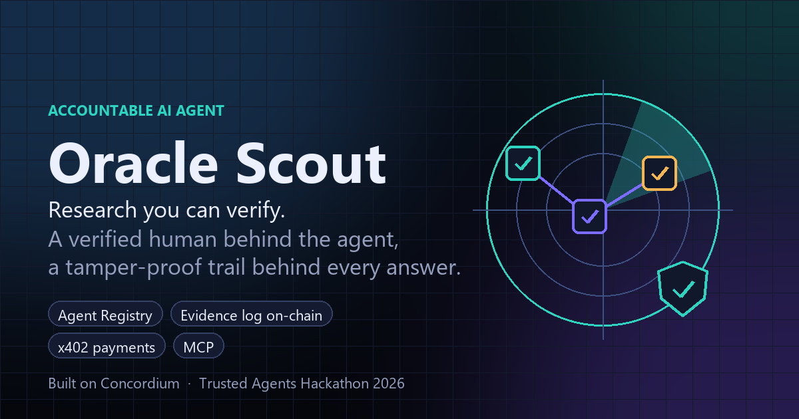
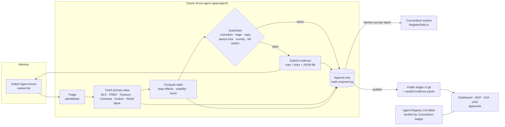
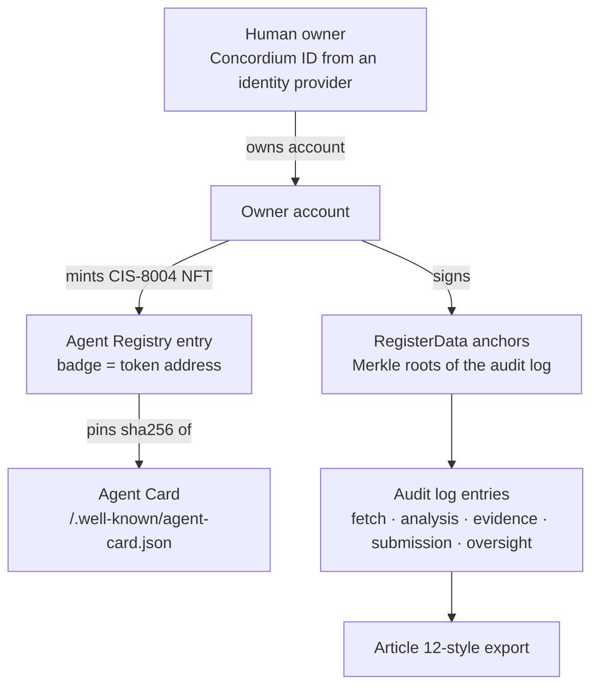
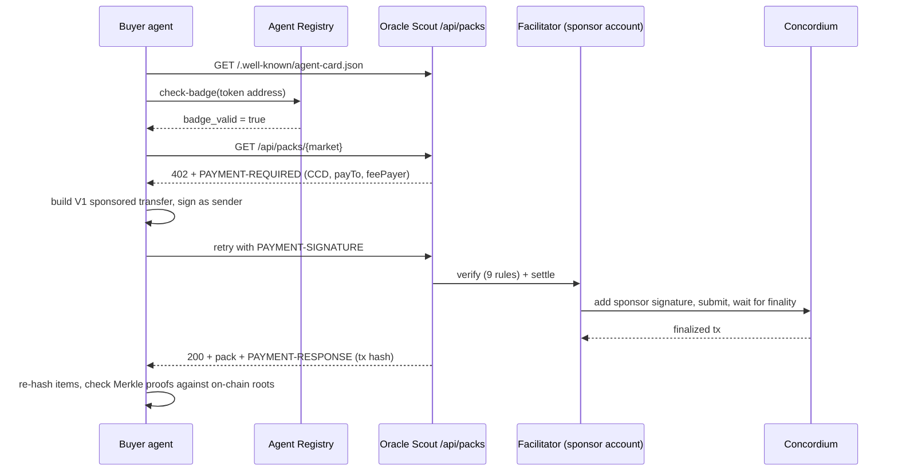

<p align="center"></p>

# Oracle Scout

**An AI evidence agent you can hold to account.** Oracle Scout reads official data (statistics offices, central banks, exchanges), works out the odds for yes/no forecasting questions, and submits dated, quoted, sourced evidence. A verified human stands behind it through the Concordium Agent Registry. Every step it takes is hash-chained into an append-only log whose Merkle roots are written to Concordium, and its full evidence packs are sold to other agents over x402.

Built for two online hackathons:

- **Concordium Trusted Agents Hackathon** (Encode Club): Agent Registry (CIS-8004) and Verified by Concordium badge, x402 payments on Concordium, an on-chain audit trail with an EU AI Act Article 12-style export, and MCP plus A2A endpoints.
- **Delphi Agent Arena: Evidence Mining** (DoraHacks): a data-first evidence miner for Delphi's prediction markets.

| | |
|---|---|
| Dashboard | `https://oracle-scout.vercel.app` (set `OS_PUBLIC_URL` to your deployment) |
| MCP | `POST /api/mcp` (stateless Streamable HTTP, JSON-RPC) |
| A2A card | `/.well-known/agent-card.json` (ERC-8004 registration file and A2A Agent Card in one) |
| x402 | `GET /api/packs/{marketId}` |
| Audit log | [`ledger/audit-log.jsonl`](ledger/), `/api/export/article12` |

---

## Why

Forecasting markets, and the AI judges behind them, reward *new, verifiable facts*. Most research agents write persuasive text. Oracle Scout does three things differently:

1. **Data first.** It only touches questions an official data series can settle, such as "Will October CPI be above 3.5%?" or "Will BTC close above $150k on 31 Dec?". It quotes the exact line the publisher returned and hashes the response, so anyone can re-fetch it and compare.
2. **Conviction or silence.** It submits only when its probability is at least 80% or at most 20% *and* differs from the market price by 10 points or more. It never argues both sides of a market (in Delphi those cancel out), and it never repeats a data point it already submitted.
3. **Accountable by construction.** The agent's owner is a verified human (Concordium identity, with no personal data published). What the agent did, and when, is provable from the chain.

## How it works



### Accountability chain



A regulator, a market operator or another agent can walk this chain backwards: from a submitted piece of evidence to its log entry, to the anchored root, to the account that signed it, to the registry entry and badge, and (under legal process, through the identity provider) to an accountable person. Nobody has to trust our server.

### Paying for evidence (x402 on Concordium)



The pack contains every evidence item for the market: the full note, each fact with its data URL, response hash and verbatim quote, the model inputs, and a Merkle proof that the item was in the agent's anchored log *before* the market resolved. Packs are published to git **encrypted** (AES-256-GCM). Only the paid endpoint decrypts them, so paying actually buys something.

## Repository layout

| Path | What |
|---|---|
| `packages/evidence` | Framework-free evidence pipeline: source adapters, odds maths, market planner, evidence items, novelty and stance checks. Reusable on its own (planned reuse: Cortensor "Resolution Desk"). |
| `packages/ledger` | Hash-chained audit log, RFC 6962 Merkle tree and inclusion proofs, Article 12 export, sealed packs. Browser-safe core. |
| `packages/concordium` | RegisterData anchoring, Agent Registry MCP client, contract updates, x402 paywall, buyer and facilitator. |
| `apps/agent` | CLI agent: Delphi adapter, run loop, guardrails, kill switch, publish. |
| `apps/web` | Next.js dashboard, x402 route, MCP and A2A endpoints, Agent Card. |
| `scripts/register-agent.ts` | Two-pass registry registration and badge pinning. |
| `scripts/buyer.ts` | Demo buyer agent: check badge → pay over x402 → verify proofs. |
| `ledger/` | The public, published audit log and sealed packs. |

## Data sources (all keyless)

| Source | Used for | Primary? |
|---|---|---|
| U.S. Bureau of Labor Statistics API v1 | CPI, core CPI, unemployment | yes |
| FRED (St. Louis Fed) CSV | fallbacks; 10-year yield, gasoline | mirror |
| U.S. Treasury Fiscal Data | national debt | yes |
| Coinbase Exchange, Kraken | crypto daily closes | yes |
| CoinGecko | crypto fallback | aggregator |
| World Bank WDI | annual macro | yes |
| Open-Meteo | weather questions | model data |

Every fetch records the URL, a sha256 of the body, and the verbatim line each number came from.

## Odds models (plain English)

- **Price thresholds (crypto):** how far the price has to move, compared with how much it normally moves. A lognormal random walk with zero drift and 60-day realised volatility gives *P(close above X on date)*. For "reach X at any point", the reflection principle gives *P(touch)*. The model does not forecast direction, only reach.
- **Next data release (CPI and similar):** base effects. To print above 3% year-on-year next month, the index must rise by m% month-on-month. The model counts how often that happened in the last 36 months (Laplace-smoothed). If the month in question is **already published**, it says so with ~99% confidence. That is the most valuable kind of evidence, because the judge may not know it yet.
- **Trend levels (debt, yields):** least-squares trend over the recent window, extrapolated to the deadline, with the residual spread as uncertainty. It is capped at 97%/3% because trends break.

## Guardrails

| Rule | Default |
|---|---|
| Conviction | P(YES) ≥ 0.80 or ≤ 0.20 |
| Edge over market price | ≥ 10 percentage points |
| Per market / per run / per day | 3 / 5 / 15 |
| Stance lock | never submit the opposite side of a market already argued |
| Novelty | no repeat of the same data point; ≥ 50% text overlap is treated as a duplicate |
| Evidence cutoff buffer | 30 min |
| Kill switch | `npm run agent -- kill on "reason"` or `OS_KILL=1`; logged as a human-oversight event |
| Dry run | default on; `--live` to submit |

## Quick start

```bash
npm install
cp .env.example .env
npm run agent -- keygen          # evidence-pack encryption key (written to .env only)
DELPHI_MARKETS_FILE=fixtures/rehearsal-markets.json npm run agent -- run --no-anchor
npm run agent -- verify          # recompute the hash chain
npm run agent -- export          # Article 12-style JSON + CSV
npm test                         # unit tests for every package
```

### Concordium setup (testnet)

1. Install Concordium Wallet for Web, switch to **Testnet**, and create an identity with *Concordium testnet IP*.
2. Create three accounts: **agent** (owner, anchors, payTo), **sponsor** (x402 fee payer) and **buyer** (demo). Request CCD on each (Activity → Request CCD).
3. Export each account's key file to `keys/agent.export`, `keys/sponsor.export` and `keys/buyer.export`. `keys/` is git-ignored, and the code only ever reads these files by path.
4. Deploy `apps/web` (see below), then register:

```bash
npm run register -- card       # writes the pre-mint Agent Card
# deploy, so the card is served at OS_PUBLIC_URL/.well-known/agent-card.json
npm run register -- register   # mints the CIS-8004 agent NFT
npm run register -- card       # rebuilds the card with token id + badge
# deploy again
npm run register -- pin        # pins the card hash on chain
npm run register -- check      # badge check through the registry API
```

5. Anchor and publish:

```bash
npm run agent -- anchor
npm run agent -- publish --push
```

### Deploying the web app (Vercel)

- Root directory: `apps/web`. Framework: Next.js.
- Environment variables:
  - `OS_PACK_KEY`: same value as in `.env`.
  - `OS_PAYTO`: the agent account address.
  - `CONCORDIUM_SPONSOR_WALLET_JSON`: the sponsor's wallet export **contents**, as a secret.
  - `OS_PACK_PRICE_MICROCCD`: optional pack price in microCCD.
  - `LEDGER_BASE_URL`: optional; defaults to this repo's `ledger/` on GitHub.

### Delphi Agent Arena

```bash
# .env: DELPHI_API_ACCESS_KEY=…  (issued 23 Nov), confirm DELPHI_EVIDENCE_PATH and header names from the agent guide
npm run agent -- markets       # which open markets primary data can settle
npm run agent -- run --live    # mine + submit (guardrails apply)
npm run agent -- receipts      # judge verdicts and rewards
```

Market listing follows the published Delphi SDK (`GET https://delphi-api.gensyn.ai/markets` with `X-API-Key` and `X-Delphi-Mode: competition`). The agent sends its ID, harness and model in request headers, as the arena asks.

## MCP tools

`get_agent_identity` · `check_badge` · `list_evidence` · `get_evidence_trail` · `verify_log_entry` · `get_pack_offer`

```json
{ "mcpServers": { "oracle-scout": { "url": "https://oracle-scout.vercel.app/api/mcp" } } }
```

Oracle Scout also uses Concordium's hosted Agent Registry MCP (`https://agent-registry-mcp.concordium.com/mcp`) to build its card, register, and check badges.

## Path to production (mainnet)

See [docs/path-to-production.md](docs/path-to-production.md).

## Honesty notes

- Test activity on testnet and rehearsal markets is labelled as such in the log (`dryRun`) and on the dashboard. It is not presented as real users or real trades.
- Oracle Scout is not a high-risk AI system under the EU AI Act. The Article 12 export follows that article as a template for good record-keeping, not as a compliance claim.
- Models are deliberately simple and explainable. When a question is not settled by data, the agent abstains.

## License

MIT
